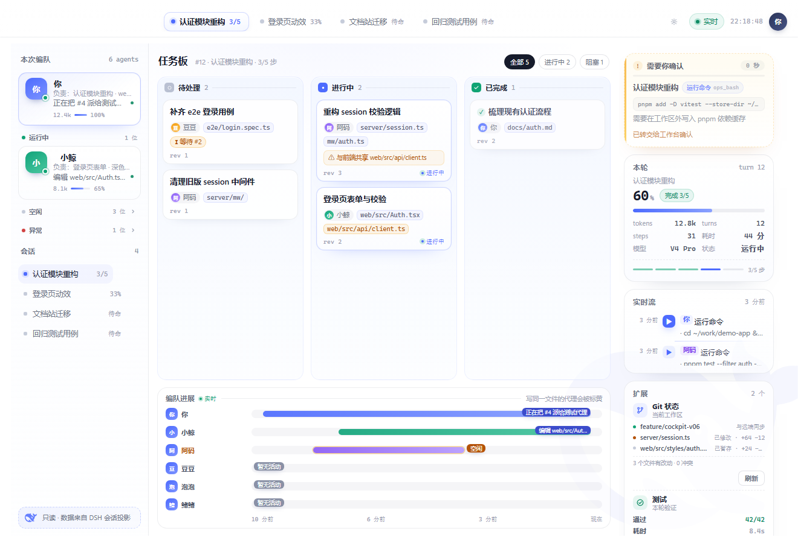
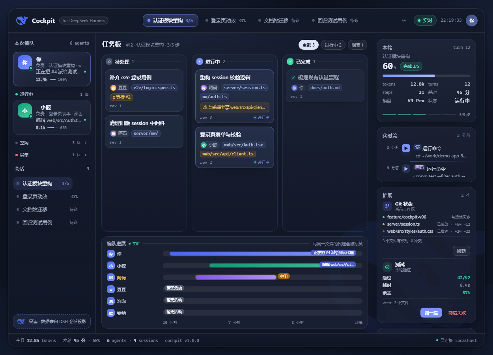
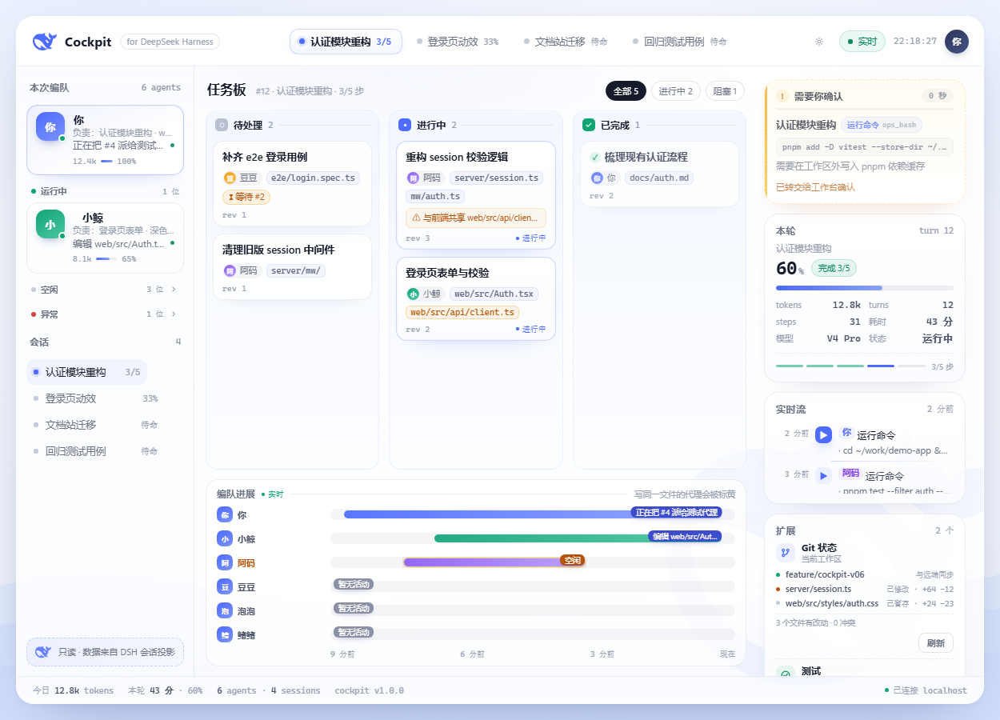
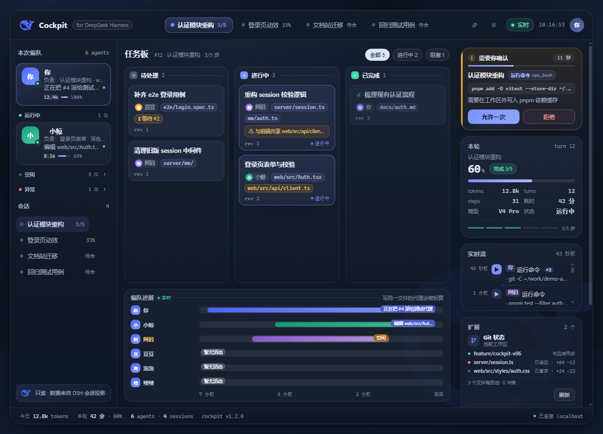
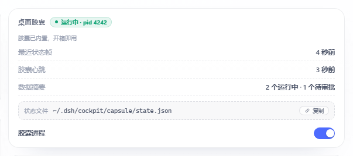
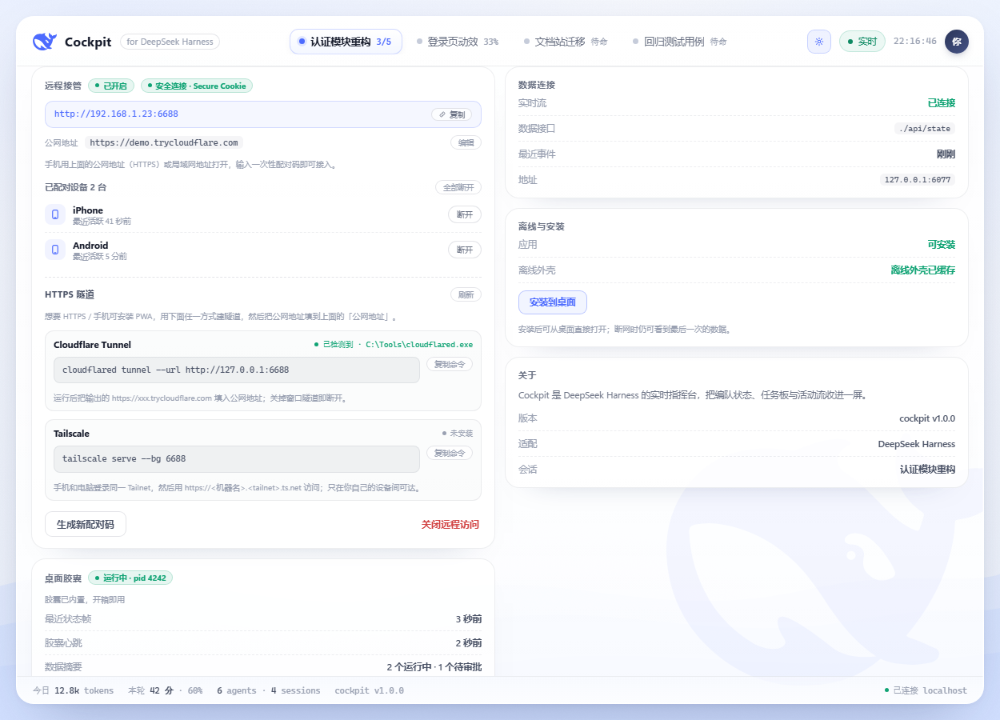
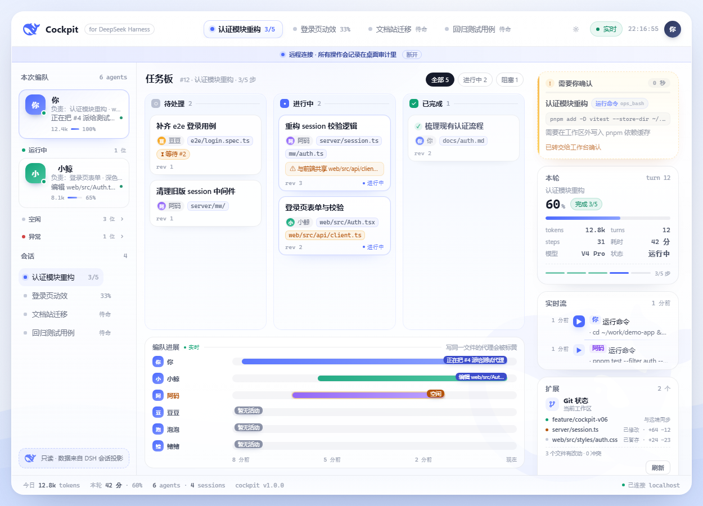
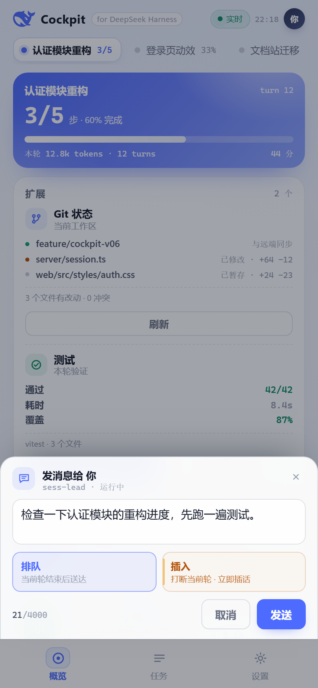
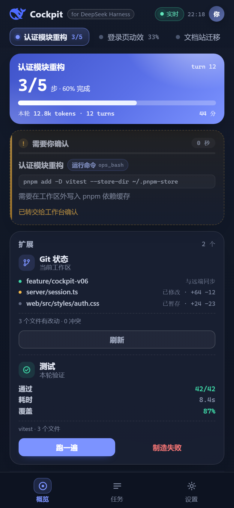

# Cockpit · 指挥台

[](https://github.com/zoe1nan/dsh-cockpit/actions/workflows/ci.yml)

**一眼看清一支 AI 编队正在做什么。**

DeepSeek Harness 支持多个 agent 并行干活。但当一支编队跑起来，你会同时面对一串会话、一堆待办、若干子代理的实时动作，以及偶尔撞车的文件写域。Cockpit 把这些收进一块实时看板：编队在干嘛、计划走到第几步、任务板卡在哪、谁刚写了什么文件——并且允许你在同一个界面里做决定：审批、发话、中断。



从 v0.2 起它**内嵌在 DSH 工作台里**：侧栏点一下「Cockpit 指挥台」，页面就在主区打开，不用另开浏览器标签、不用记端口。独立 URL 也保留，方便第二块屏或手机。







---

## 特性（v1.1）

### 看
- **实时编队**：每个成员的模型、真实 token 数、当前动作、负责范围（自动从任务主题/改动文件归纳）；按运行中 / 空闲 / 异常分组，运行中永远在前
- **任务板**：共享任务、状态列、依赖关系（`blockedBy`）、两人的写域重叠会被标成「双写风险」
- **计划兜底**：没有共享任务板时，自动用本轮 todo 计划铺满看板，永远不空
- **实时流**：工具调用说人话（`运行命令` / `编辑文件` / `搜索内容` …），参数一行省略、点击展开
- **本轮数据**：进度、token、耗时、步骤、模型、状态，液面进度条随事件实时更新
- **会话切换**：点左栏会话或顶部 pill 即切换，每个标签页记住自己的选择；顶栏「复制链接」给出可分享的视图链接，别人打开就落在同一个会话（v1.1）
- **自检与诊断**：设置页一键自检（插件 / 状态数据 / 实时流 / 胶囊 / HUD 桥 / 远程 / 待审批 / 宿主接口），异常一眼可见，可复制完整报告发给维护者（v1.1）

### 操作
- **审批闸口**：审批请求直接出现在 deck 里，允许一次 / 拒绝；25 秒不处理自动交回原生弹窗
- **发消息**：对某个 agent 排队送达，或「插入」打断当前轮立刻插话
- **中断**：行内确认后停止正在跑的轮
- **所有写操作**：同源校验、失败回滚、本地审计（`~/.dsh/cockpit/audit.jsonl`）

### 桌面胶囊（Windows）
装一个插件就有桌面悬浮胶囊：液体进度条 + 步骤读数 + 「N 跑 · M 批」徽标；点击展开完整卡片，可一键打开指挥台。胶囊跟随**任意正在运行的对话**（1.0.1 起：谁在干活就显示谁，多个同时运行时跟随你最近输入的那个，空下来回到「待命」），不再只盯着指挥台会话。v1.1 起点击胶囊本体直接打开指挥台（有待审批时直接落在审批区），右上箭头才展开/收起卡片。胶囊进程由插件托管（自动启动/退出/崩溃重启），设置页可启停。



### 手机 / 远程


- 局域网一次性配对码（6 位、2 分钟有效、单次使用、错误限速），手机浏览器即可接管
- 需要 HTTPS 时给出隧道向导（检测 cloudflared / Tailscale，只给命令，不替你执行）
- 公网 HTTPS 地址 + Secure Cookie；配对设备可随时撤销
- 审批到达时（页面在后台）可发系统通知
- PWA：可安装、离线外壳、断网提醒







### 界面
- 内嵌工作台 / 独立页 / 手机单栏三套布局，列宽可拖、双击复位，宽度本地记忆
- 深色模式跟随工作台主题；1250/1000/390 三档适配；reduced-motion 与键盘可达
- 字体统一无衬线栈；数字等宽

---

## 安装

前置：DeepSeek Harness（带插件系统与客户端模块）、Node.js ≥ 22；**桌面胶囊仅 Windows 10 2004+**，其他平台 deck 正常、胶囊自动隐藏。

1. 下载 `dsh-cockpit-<version>.tgz`（Releases 或本地 `npm pack`）
2. 安装到你的 profile 并重启：

```bash
dsh plugin --profile <profile> add /path/to/dsh-cockpit-1.1.0.tgz
```

3. 重启 DSH 后：侧栏出现「Cockpit 指挥台」，点开即用；桌面胶囊随宿主自动启动（Windows）。

独立访问：`http://127.0.0.1:<DSH 端口>/cockpit/`。

升级：重复 `add` 新版本 tgz 后重启；设置与别名保存在 `~/.dsh/cockpit/`，升级不丢。
卸载：`dsh plugin --profile <profile> remove dsh-cockpit`，再重启。

---

## 安全与隐私

- **本地优先**：插件只监听本机 DSH 端口；不向任何服务器上报数据；文档中的截图与示例均为演示数据
- **默认只读**：除你点击触发的审批 / 发消息 / 中断外，不派生 agent、不改任务、不自动同意
- **审批**：只回答 once 决策，25 秒超时即交回原生弹窗；可用 `DSH_COCKPIT_APPROVALS=0` 完全关闭接管
- **远程**：默认关闭；开启后只绑私有网段，只代理 `/cockpit/*`；6 位一次性配对码、失败限速（重启仍保留）、会话 HttpOnly + SameSite；设备可撤销；所有远程操作带 `remote:true` 审计
- **扩展卡**：其他插件只能提交纯 JSON 只读内容，宿主做类型 / 长度 / 超时校验
- 环境变量：`DSH_COCKPIT_REMOTE_PORT`（默认 6688）、`DSH_COCKPIT_REMOTE_SECURE=1`（强制 Secure Cookie）、`DSH_COCKPIT_APPROVAL_HOLD_MS`、`DSH_COCKPIT_APPROVALS=0`

---

## 扩展卡片（给插件作者）

任何插件都可以把自己的只读信息卡注册进 deck：

```js
export function apply(ctx) {
  ctx.inject(['cockpit'], (ctx) => {
    ctx.cockpit.registerCard({
      id: 'git-status',
      title: 'Git 状态',
      subtitle: '当前工作区',
      order: 10,
      async load() {
        return { kind: 'list', items: [{ label: 'main', value: '与远端同步', tone: 'ok' }] }
      },
      actions: [{ id: 'refresh', label: '刷新', kind: 'primary' }],
      async onAction({ action }) {
        if (action === 'refresh') return { toast: '已刷新' }
      },
    })
  })
}
```

- 载荷类型：`list` / `metrics` / `status` / `text`（纯 JSON，无 HTML）
- 宿主负责超时、缓存、数量上限与错误隔离；动作走 `POST /cockpit/api/cards/<id>/action`（同源）
- 完整契约见 [docs/STATE.md](docs/STATE.md)，可安装示例见 [examples/git-card](examples/git-card)

---

## 已知限制

- 桌面胶囊仅 Windows；macOS / Linux 只有 deck
- PWA 安装与系统通知要求安全上下文（HTTPS 或 localhost）；局域网 HTTP 只能当网页用（设置页会提示）
- 后台 Web Push 尚未实现，当前只有前台/系统通知
- DSH 团队模型只增不减：同一会话里 teammate 无法删除，Cockpit 用折叠分组保持界面干净

---

## 开发

```bash
npm run preview      # http://127.0.0.1:6077/cockpit/ 本地预览（mock 数据 + 假后端）
npm run smoke        # 预览冒烟：起服务抓页面 / state / diagnostics / SSE（CI 同款）
npm run check        # 资产守卫：overlay.ps1 BOM/编码、app.css 括号、文档版本一致性
```

目录：

```
index.js        host 插件：会话投影、写操作、审批、胶囊监管、远程访问、扩展卡
client.js       客户端半：侧栏入口 + 主区面板（iframe）
public/         deck 前端（原生 ES module，无构建、无 CDN）
capsule/        Windows 桌面胶囊（WPF / PowerShell）
mock/           预览用演示数据
examples/       扩展卡示例
docs/           契约与路线图
```

契约（state 字段、SSE、端点、审批/动作语义）见 [docs/STATE.md](docs/STATE.md)；路线图见 [docs/ROADMAP.md](docs/ROADMAP.md)。

---

## English

**Cockpit is a live command deck for DeepSeek Harness agent teams.** It answers one question — what is the team doing right now — and lets you act on it in the same place.

- Embedded in the workspace (sidebar entry) or standalone at `/cockpit/`
- Live roster with real per-agent tokens / actions / ownership, task board with dependencies and write-scope conflict warnings, plan fallback when no shared board exists, human-readable activity stream
- Approvals gate, queue / steer messages, interrupt a running turn — all click-driven, with a local audit log
- Shareable view links: the header "copy link" button encodes the conversation on screen, so opening it lands on the same session (v1.1)
- One-click self-check in settings (plugin, state, stream, capsule, HUD bridge, remote, approvals, host API) with a copyable report for bug reports (v1.1)
- Built-in desktop capsule (Windows): liquid progress bar + badges; follows whichever conversation is working (v1.0.1 — most recently used conversation wins among several, returns to standby when idle); clicking the capsule opens the deck, the chevron toggles the card (v1.1), managed by the plugin, toggle in settings
- Phone access: one-time pairing code, optional HTTPS tunnel wizard, Secure cookies, notifications, installable PWA
- Extension cards: other plugins register read-only JSON cards with actions
- Local-first: no telemetry; only the explicit actions you take write back to DSH

Install: `dsh plugin --profile <profile> add /path/to/dsh-cockpit-1.1.0.tgz`, restart DSH, then open **Cockpit** in the sidebar.

Windows capsule requires Windows 10 2004+. PWA install and notifications need a secure context (HTTPS or localhost). Backend Web Push is not implemented yet.

MIT licensed. Not affiliated with DeepSeek.

---

## License

[MIT](LICENSE)
